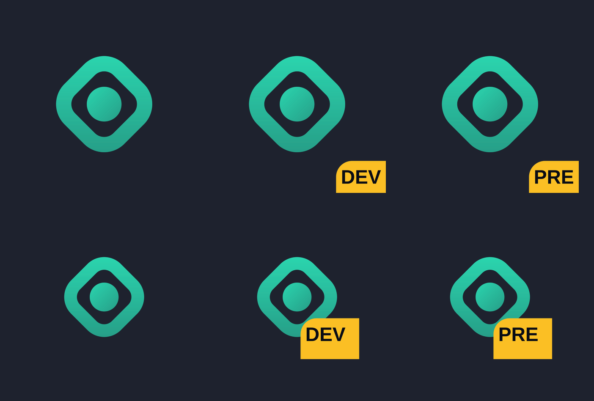

# Portal App Icon

Design and install a professional, brand-consistent **app icon** for an Expo project
managed by the [Portal CLI](https://www.npmjs.com/package/@portalcloud-io/cli),
replacing the neutral default glyph.



## What it does

- Turns a short app brief into a clean, **hand-authored SVG** glyph — no image API.
- Writes `assets/glyph.svg` and patches `assets/icon-source.json`.
- Syncs the brand background across the iOS 26 `.icon` fill, the Android adaptive
  background, and the splash screen.
- Runs the Portal icon factory so **one design becomes 15 per-variant assets**
  (`production` / `preview` / `development`).
- Audits geometry, centering, safe zones, contrast, monochrome readability, and
  small-size legibility, then iterates on a visual rubric.

## Install

```bash
npx skills add https://github.com/portalcloud-io/skills --skill portal-app-icon
```

## When to use

- You just ran `portal init` and want to replace the default diamond glyph.
- You need an elegant launcher icon with proper iOS 26 and Android adaptive support.
- An existing icon looks generic or "AI generated" and needs a redesign.

## Usage

Ask your agent in natural language:

```text
Create an app icon for my Portal app. It is a calm habit tracker; make it feel
premium and geometric. Show me a few concepts, then install the best one.
```

The skill drives the whole flow:

```text
brief → concepts → assets/glyph.svg → portal icons generate/check/preview → audit → critique loop
```

## Requirements

- A Portal-managed Expo project (`assets/glyph.svg` + `assets/icon-source.json`).
- The Portal CLI (`@portalcloud-io/cli`) available locally or via `npx`.
- `sharp` resolvable from the project or the Portal CLI (it ships with the CLI).

## Structure

```text
skills/portal-app-icon/
  SKILL.md
  references/{brief-template, svg-authoring-contract, concepts-and-styles, design-rubric}.md
  scripts/{detect, audit-icon, preview}.mjs
```

## License

[Apache-2.0](../../LICENSE)
